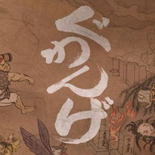

<div align=center>



</div>
<h1 align=center>guwange-nx installer</h1>

The installer page of [guwange-nx](https://github.com/ChanseyIsTheBest/guwange-nx), the native Nintendo Switch port of
Guwange (Xbox Live Arcade): **https://chanseyisthebest.github.io/guwange-nx-installer/**

You give it your own copy of the game and its Title Update #1, and it gives you a zip ready to extract into
`sdmc:/switch/`. Everything runs in your browser: the game files never leave your computer.

## What it does

1. **Finds your files** in what you chose (files or a whole folder):
   - the game: its content package `92ED9E87CBCB7292EC7ACD321AA6704531D395A558` (title `58410A78`, content type
     `0x000D0000`, read in place: `lib/from_sa2/stfs_package.js`), or a folder it was extracted into (`default.xex`
     with `module/` and `res/`);
   - Title Update #1: its package (content type `0x000B0000`, e.g. `TU_1C422JO_000000G000000.0000000000084`), or its
     `default.xexp` and `module/*.dllp` in a folder (the game's folder is fine). It is needed: the port's code is the
     updated executables'.
2. **Checks them** against `release/manifest.json`: `default.xex` and the title update's five files by their SHA-256,
   the game's other files by their sizes.
3. **Downloads the build's NRO** and checks its SHA-256.
4. **Makes the renderer's shaders** (`deko3d_glsl.bin`), futari-nx's chain in the page (guwange-nx shares its
   renderer):
   - the title update applied to `default.xex` as the console does (`lib/xexp.js`, peggle1-nx-installer's: the
     runtime's XEX patch steps, with libmspack's LZX delta decoder in `wasm/lzxdelta.*`), and the 68 shader
     containers the patched executable stores (`lib/containers.js`);
   - the 10 of the sprite effects the game compiles at run time (`game_res/shader/*.cfx` and `pkgres/sprite_i_360.cfx`
     in `res/DSD000.bin` and `DSD100.bin`), read from the resource archives with the game's own LZSS
     (`lib/dsd.js`, from `sub_821FDE00` of `default.xex`);
   - each translated by Renut's XenosRecomp (`wasm/renut_hlsl`), the alpha-tested pixel shaders given their early
     alpha copy (`lib/early_alpha.js`), compiled by DXC (`wasm/dxc_web`), turned into GLSL by SPIRV-Cross
     (`wasm/spirv_cross`) and trimmed for the console's shader compiler (`lib/deko3d_glsl.js`, with guwange-nx's
     bound fetch pass), then packed (`lib/deko3d_package.js`). The package must match the manifest's SHA-256: it is
     the one the release was tested with.

   The NRO carries the 9 other shaders itself: no game file holds them (the runtime builds them).
5. **Streams the zip to disk** through the service worker, so nothing large has to fit in memory.

The zip holds `guwange-nx/guwange.nro` with its `LICENSES.txt`, `deko3d_glsl.bin` and `game_root/`: the game's files
with the title update's beside them (the console applies `default.xexp` and the `.dllp` patches at start, as the Xbox
360 does). The update zip holds the NRO, its licenses and the shaders. Neither holds `guwange.toml`: the game writes it
at its first start, so an update never overwrites your settings.

## Checks

- `test/deko3d_node.mjs`: the page's 78 shaders against guwange-nx's native chain (`out/deko3d_shaders/glsl_opt`):
  every one has the native chain's code, with other SPIR-V temporary numbers (the page's DXC v2025.1 numbers them
  differently).
- `test/package_node.mjs`: the whole zip in Node with the page's code.
- `test/browser_package.html`: the same in the browser.
- `test/texts_node.mjs`: the interface texts (English and Japanese).

## Layout

| Path | Contents |
|---|---|
| `index.html`, `app.js` | The page and its interface (`lib/i18n.js`) |
| `worker.js` | Builds the package off the main thread |
| `sw.js` | Offline cache and the download stream |
| `lib/` | STFS package reader, XEX reader and patcher, shader containers, resource archive reader, deko3d shader chain, zip writer |
| `wasm/` | WebAssembly builds: DXC and the LZX decoder (futari-nx-installer's), the LZX delta decoder (`wasm/src/lzx/`, peggle1-nx-installer's), Renut's shader translator and SPIRV-Cross (`wasm/src/deko3d/build_wasm_deko3d.sh`; the same translator sources as futari-nx's and guwange-nx's) |
| `release/` | The list of builds and the licenses of the NRO; the deployment adds the NRO from the guwange-nx release |
| `test/` | Node scripts and a browser page that run the same code as the page |

## Publishing a build

The NRO is not stored here: it is the `guwange.nro` asset of a release of the guwange-nx repository of the same owner
(a build with `-ReleaseShaders on`). The workflow in `.github/workflows/deploy.yml` downloads it from the latest
release, checks its SHA-256 against the list and publishes the page on GitHub Pages. It runs on every push to `main`;
after publishing a new release, run it by hand from the Actions tab. Pages must be set to deploy from GitHub Actions
(Settings > Pages > Source).

To publish a new build, put its NRO in `release/` and write the build's entry of `release/manifest.json` from your own
copy with the page's code (it also leaves the page's `deko3d_glsl.bin` in `release/`, not committed: test the NRO with
exactly that file next to it):

```sh
node test/manifest_node.mjs <game package or folder> <title update package or folder> --version 1.0.0 --write
```

## Testing locally

Put `guwange.nro` in `release/` and serve the folder (any static server works; this one sets the right MIME types):

```sh
python serve.py 8193
```

Then open http://127.0.0.1:8193/. The same code runs in Node:

```sh
node test/package_node.mjs guwange-nx.zip <game package or folder> <title update package or folder>
node test/package_node.mjs guwange-nx-update.zip <game package or folder> <title update package or folder> --update
node test/deko3d_node.mjs <game> <title update> --native <guwange-nx's out/deko3d_shaders/glsl_opt>
node test/texts_node.mjs
```

## License

GPL-3.0 (see [LICENSE](LICENSE)). Third-party components are listed in [NOTICES.md](NOTICES.md). The page is built on
[peggle1-nx-installer](https://github.com/ChanseyIsTheBest/peggle1-nx-installer) and
[futari-nx-installer](https://github.com/ChanseyIsTheBest/futari-nx-installer), themselves built on
[peggle2-nx-installer](https://github.com/ChanseyIsTheBest/peggle2-nx-installer),
[sa2-nx-installer](https://github.com/ChanseyIsTheBest/sa2-nx-installer) and
[nfsmw-nx-installer](https://github.com/StevensND/nfsmw-nx-installer) by StevensND. Renut's renderer is reNut's, by
reNut and masterspike52.

Guwange is a trademark of CAVE Interactive; the icon artwork is © CAVE. This project is not affiliated with or endorsed
by CAVE, Nintendo or Microsoft.
